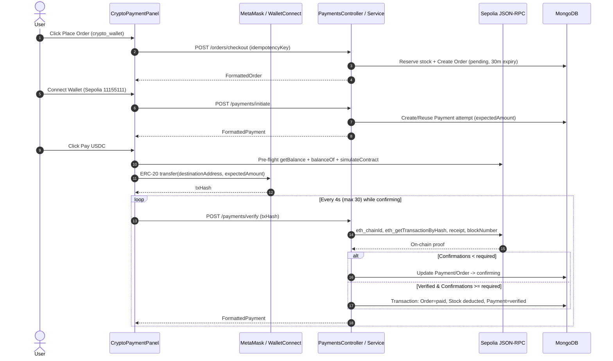

# 01 — Architecture Overview

## Core Design Philosophy

APEX ATELIER uses a **non-custodial, server-verified** cryptocurrency payment architecture:

1. **Non-custodial**: The backend never creates wallets, stores seed phrases, or requests private keys. The customer signs transactions directly in their browser/mobile wallet (MetaMask or WalletConnect).
2. **Untrusted frontend**: The browser submits a `transactionHash`, but the backend **never trusts** frontend claims of success. `BlockchainVerifierService` independently queries `CRYPTO_RPC_URL` to inspect the chain, receipt, ERC-20 `Transfer` logs, sender, recipient, amount, and block confirmations.
3. **Order-first settlement**: An `Order` document is created and reserves inventory **before** any blockchain transfer occurs. The `Order` holds the authoritative settlement state (`paymentStatus`), while `Payment` documents track individual on-chain attempts.

---

## Backend Module Architecture

Following `backend/AGENTS.md`, the backend uses a strict layered NestJS + Repository Pattern architecture:

```text
HTTP Request (JWT Auth)
  └── PaymentsController        (HTTP routing, DTO validation)
        └── PaymentsService     (Business logic, BigInt math, atomic orchestration)
              ├── IPaymentRepository ──▶ MongoPaymentRepository ──▶ MongoDB (payments)
              ├── BlockchainVerifierService ──▶ EVM JSON-RPC (CRYPTO_RPC_URL)
              ├── OrdersService ──▶ IOrderRepository ──▶ MongoOrderRepository ──▶ MongoDB (orders)
              └── ProductsService ──▶ IProductRepository ──▶ MongoProductRepository ──▶ MongoDB (products)
```

### Module Boundaries
- `PaymentsModule` (`backend/src/modules/payments/payments.module.ts`) imports `OrdersModule` and `ProductsModule` and communicates with them exclusively through exported `OrdersService` and `ProductsService`.
- `PaymentsService` depends on `IPaymentRepository` via the `@Inject(PAYMENT_REPOSITORY)` token rather than Mongoose directly (except `@InjectConnection()` for optional MongoDB transactions).

---

## Frontend Architecture

```text
app/layout.tsx
  └── Web3Provider (WagmiProvider + QueryClientProvider + client-only AppKit init)
        └── CheckoutClient / OrderDetailClient
              └── CryptoPaymentPanel
                    ├── useEvmWallet (AppKit modal, Wagmi account/chain/writeContract/publicClient)
                    └── lib/api/payments.api.ts (apiFetch -> Axios instance with cookie refresh)
```

---

## End-to-End Flow



---

## Related Documents
- [02 — Libraries & Dependencies](./02-libraries-and-dependencies.md)
- [03 — Crypto Payment Flow](./03-crypto-payment-flow.md)
- [14 — Database Models & Relations](./14-database-models-and-relations.md)
