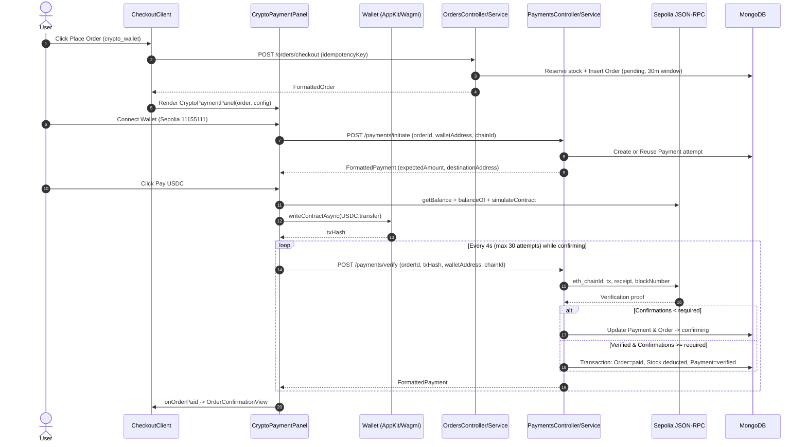

# 02 — End-to-End Payment Flow

## Complete Customer Journey

1. **Cart & Checkout (`/checkout`)**: `CheckoutClient.tsx` loads user addresses and `GET /api/v1/payments/config`. Customer selects a shipping address and **Crypto Wallet** (`paymentMethod: "crypto_wallet"`).
2. **Order Creation (`POST /api/v1/orders/checkout`)**: `OrdersService.checkout()` checks `idempotencyKey`, validates cart stock, atomically reserves inventory (`productsService.reserveStock`), creates the `Order` (`paymentStatus: 'pending'`, `fulfilmentStatus: 'placed'`, 30-minute `paymentExpiresAt`), and clears the cart.
3. **Wallet Connection**: `CheckoutClient` mounts `<CryptoPaymentPanel />`. User connects MetaMask or a mobile wallet via Reown AppKit (`useEvmWallet().connect()`) and switches to Sepolia (`11155111`) if needed.
4. **Payment Initiation (`POST /api/v1/payments/initiate`)**: `PaymentsService.initiatePayment()` locks `expectedAmount` (`BigInt` cents `× 10^4`), `tokenAddress`, and `destinationAddress` in a `Payment` attempt.
5. **Wallet Transfer**: `useEvmWallet.sendPaymentTransaction()` runs pre-flight gas/USDC/simulation checks and signs `USDC.transfer(destinationAddress, expectedAmount)` via `writeContractAsync`, returning `txHash`.
6. **Backend Verification & Polling (`POST /api/v1/payments/verify`)**: Frontend submits `txHash` and polls every **4 seconds** (up to 30 times) while `confirming`. Once `confirmations >= 3` and all checks pass, the backend runs a MongoDB transaction marking `Order` **`paid`** (`payment_confirmed`), deducting reserved stock, and marking `Payment` **`verified`**.
7. **Completion**: `onOrderPaid` transitions `/checkout` to `OrderConfirmationView`.

---

## Sequence Diagram

---

## Checkout Branching & Resume Flows

- **COD vs Crypto**: If `paymentMethod === "cod"`, `CheckoutClient` skips `CryptoPaymentPanel` and shows `OrderConfirmationView` immediately.
- **COD → Online Crypto Conversion**: An unpaid COD order (`fulfilmentStatus === 'placed'`, `paymentStatus` in `['pending', 'failed']`) can open `/checkout?orderId=<id>`. Once crypto payment is verified, `PaymentsService.verifyPayment()` updates `order.paymentMethod` from `'cod'` to `'crypto_wallet'`.
- **Page Refresh / Resume**: `CheckoutClient` reads `?orderId=` (`resumeOrderId`) and calls `getOrderById` + `getPaymentByOrder`. If an unresolved `confirming` attempt with a `transactionHash` exists, polling resumes automatically without allowing a duplicate wallet transfer.

---

## API Endpoints Reference

Base URL: `/api/v1` (`PaymentsController` + `AdminPaymentsController`).

| Method & Route | Auth | Request DTO / Query | Success Response & Key Errors |
| :--- | :--- | :--- | :--- |
| `GET /payments/config` | `@Public()` | None | `200 OK`: `{ chainId, network, token, tokenAddress, tokenDecimals, destinationAddress, requiredConfirmations }` |
| `POST /payments/initiate` | `JwtAuthGuard` | `InitiatePaymentDto`: `orderId` (`@IsMongoId`), `walletAddress` (`0x...40`), `chainId?` (`@IsInt`) | `200 OK`: `FormattedPayment`. Errors: `400` (wrong chain, expired, invalid status), `404`, `409` (already paid / concurrent lock), `503` (missing wallet/token config) |
| `POST /payments/verify` | `JwtAuthGuard` | `VerifyPaymentDto`: `orderId`, `transactionHash` (`0x...64`), `walletAddress`, `chainId` | `200 OK`: `FormattedPayment` (`confirming` or `verified`). Errors: `400` (`underpaid`, `overpaid`, `reverted`, `wrong_token`, `wrong_network`, `expired`, `failed`), `404`, `409` (reused `txHash`), `503` (RPC outage) |
| `GET /payments/order/:orderId` | `JwtAuthGuard` | Param: `orderId` | `200 OK`: Latest `FormattedPayment` for `(orderId, userId)` or `null` |
| `GET /admin/payments/summary` | `RolesGuard` (`admin`) | None | `200 OK`: `{ collectedRevenue, successfulPayments, pendingPayments, failedExpiredPayments, cryptoRevenue, codCollected }` |
| `GET /admin/payments` | `RolesGuard` (`admin`) | `AdminPaymentQueryDto`: `page`, `limit`, `search`, `status`, `paymentMethod`, `dateFrom`, `dateTo` | `200 OK`: Paginated unified crypto + COD transactions |
| `GET /admin/payments/:transactionId` | `RolesGuard` (`admin`) | Param: `transactionId` | `200 OK`: Read-only payment detail + `attemptHistory` |
