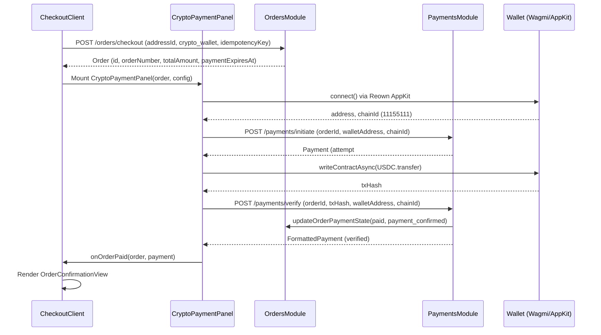

# 04 — Checkout Integration

Crypto payments integrate into two customer flows: **initial checkout** (`/checkout`) and **order detail / COD conversion** (`/profile/orders/[orderId]` → `/checkout?orderId=<id>`).

---

## Involved Frontend Components

| Component / File | Role |
| :--- | :--- |
| `client-web/src/components/checkout/CheckoutClient.tsx` | Boots auth/addresses/payment config, creates order via `createCheckoutOrder`, handles `resumeOrderId` query param |
| `client-web/src/components/checkout/CryptoPaymentPanel.tsx` | Renders wallet connection, balances, treasury address, Pay CTA, polling, and retry UI |
| `client-web/src/components/checkout/OrderSummaryPanel.tsx` | Displays order line items and authoritative USD total |
| `client-web/src/components/checkout/OrderConfirmationView.tsx` | Shown once COD order is placed OR crypto payment reaches `verified` |

---

## Branching Between COD and Crypto

In `CheckoutClient.tsx`:
- **`paymentMethod === "cod"`**: Calling `POST /orders/checkout` creates the order (`paymentStatus: "pending"`, `fulfilmentStatus: "placed"`) and immediately sets `confirmed = true`, showing `OrderConfirmationView`. No `Payment` record is created.
- **`paymentMethod === "crypto_wallet"`**: Creating the order sets `activeOrder`, clears the Zustand cart, updates URL to `/checkout?orderId=<order.id>`, and renders `<CryptoPaymentPanel order={activeOrder} config={paymentConfig} ... />`.

---

## Sequence: Checkout → Payment → Verification

---

## Edge Cases in Checkout Integration

1. **User closes MetaMask / rejects transaction**:
   - `writeContractAsync` throws (`code: 4001` / `"User rejected"`).
   - `useEvmWallet` normalizes this to `"Request was rejected in your wallet."` and displays it in `CryptoPaymentPanel`.
   - No `txHash` was broadcast; the `pending` `Payment` attempt remains reusable on retry.
2. **User refreshes `/checkout?orderId=<id>`**:
   - `CheckoutClient` reads `resumeOrderId` from `searchParams`, fetches `getOrderById(resumeOrderId)` and `getPaymentByOrder(resumeOrderId)`.
   - If the latest `Payment` already has a `transactionHash` and status `confirming` or `pending`, `CryptoPaymentPanel` **immediately resumes 4s polling** without allowing a duplicate wallet transfer.
3. **COD → Online Crypto Conversion**:
   - An unpaid COD order (`fulfilmentStatus: "placed"`, `paymentStatus: "pending" | "failed"`) can be routed to `/checkout?orderId=<id>`.
   - `PaymentsService.initiatePayment()` permits COD orders in those states, and once verified on-chain, `PaymentsService.verifyPayment()` updates `order.paymentMethod` from `'cod'` to `'crypto_wallet'`.
4. **Payment Fails (e.g., `underpaid`, `reverted`)**:
   - `isTerminalRejected` becomes `true`. The button updates to `Retry Payment (New Attempt)`, which calls `initiatePayment` to create `attemptNumber + 1` before prompting the wallet again.
