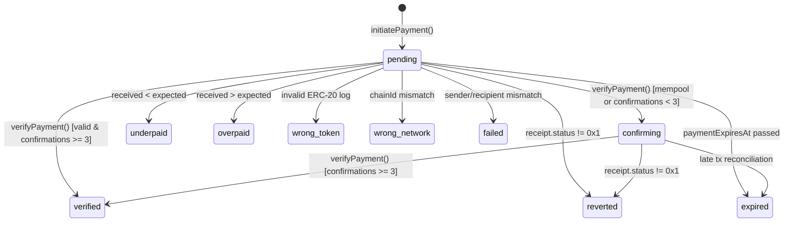

# 04 — Payment State and Idempotency

## Database Models & Relationship (`Order` vs `Payment`)

`Order` (`orders` collection) and `Payment` (`payments` collection) have a **1-to-many** relationship:
- **`Order`** (`backend/src/modules/orders/schemas/order.schema.ts`): Created first at checkout. Single source of truth for settlement (`paymentStatus`, `totalAmount`, `paidAt`, `stockReserved`) and admin revenue.
- **`Payment`** (`backend/src/modules/payments/schemas/payment.schema.ts`): Created on `POST /payments/initiate`. Tracks each crypto attempt (`attemptNumber`, `paymentReference`, `transactionHash`, `expectedAmount`, `receivedAmount`, `confirmations`, `verificationStatus`, `failureReason`, `verifiedAt`).

```text
Order (orders) — Settlement & Revenue Truth
 ├── _id, orderNumber, paymentReference, idempotencyKey, totalAmount (cents)
 ├── paymentMethod ('crypto_wallet' | 'cod'), paymentStatus, fulfilmentStatus
 └── Payment Attempts (payments) — On-Chain Audit Trail
       ├── Attempt #1: PAY-ABC123    -> underpaid (terminal)
       ├── Attempt #2: PAY-ABC123-2  -> reverted  (terminal)
       └── Attempt #3: PAY-ABC123-3  -> verified  (Order -> paid)
```

### Key Indexes
- **`payments`**: `paymentReference` (`unique`), `{ chainId: 1, transactionHash: 1 }` (`unique` partial where `transactionHash` is a string), `{ order: 1, attemptNumber: -1 }`, `{ orderPaymentReference: 1 }`, `{ verificationStatus: 1, expiresAt: 1 }`.
- **`orders`**: `orderNumber` (`unique`), `paymentReference` (`unique`), `{ user: 1, idempotencyKey: 1 }` (`unique` partial), `{ user: 1, createdAt: -1 }`, `{ paymentExpiresAt: 1 }` (partial for `pending`).

---

## Payment Lifecycle & State Transitions



- **`verified`**: Irreversible. Atomically transitions `Order` (`paymentStatus: 'paid'`, `fulfilmentStatus: 'payment_confirmed'`, `stockReserved: false`) and calls `productsService.confirmStockDeduction()`.
- **Terminal rejections (`underpaid`, `overpaid`, `wrong_token`, `wrong_network`, `reverted`, `failed`)**: Set `order.paymentStatus = 'failed'`; user can retry by initiating a new attempt (`attemptNumber + 1`).
- **`expired`**: Sets `order.paymentStatus = 'expired'`, `fulfilmentStatus = 'cancelled'`, and releases reserved stock.

---

## Amount Math & Idempotency Strategy

### Exact `BigInt` Calculation (`PaymentsService.calculateExpectedAmount`)
Converts USD cents to token base units (`cents * 10^(decimals - 2)`), e.g., `$1,650.00` (`165000` cents) → `"1650000000"` 6-decimal USDC base units.

### Duplicate Prevention Across All Stages
1. **Checkout (`POST /orders/checkout`)**: `idempotencyKey` checked in `OrdersService.checkout()` + `{ user, idempotencyKey }` unique partial index (`409 Conflict` on duplicate).
2. **Initiation (`POST /payments/initiate`)**:
   - Frontend `initiateInFlightRef` lock in `CryptoPaymentPanel.tsx` prevents React StrictMode double-mounts or double-clicks from firing parallel requests.
   - Backend returns unresolved `pending`/`confirming` attempts with a `transactionHash`, or updates unsubmitted `pending` attempts in place.
   - **Graceful `E11000` recovery**: If two concurrent `initiatePayment()` requests race on `paymentReference` (`code === 11000`), `PaymentsService` catches `isDuplicateKeyError(error)`, re-fetches `findLatestByOrderAndUser`, and returns the active `pending`/`confirming` payment idempotently (or throws `409 ConflictException` without leaking raw DB errors).
3. **Verification (`POST /payments/verify`)**:
   - **Already paid**: Returns existing verified payment if `txHash` matches (`200 OK`); rejects different `txHash` (`409`).
   - **Replay protection**: `findByChainAndTxHash` + `{ chainId, transactionHash }` unique partial index blocks reusing a `txHash` across orders (`409`).
   - **Concurrent finality**: `executeWithOptionalTransaction` + atomic `updateOrderPaymentState` (`allowedCurrentPaymentStatuses: ['pending', 'confirming', 'failed']`) ensures only one request can mark an order `paid` and deduct stock. *(Note: Full multi-collection rollback requires MongoDB to run as a replica set.)*
