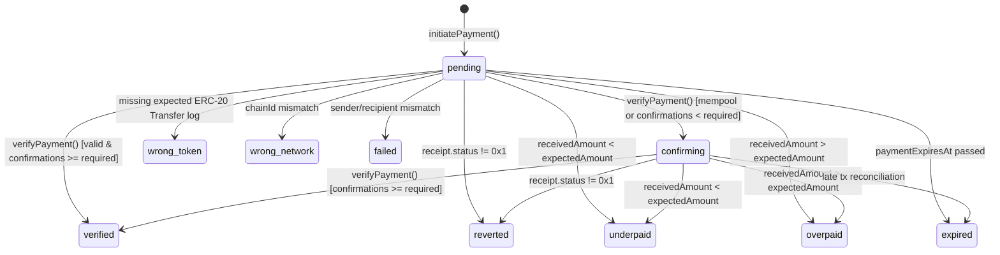

# 05 — Order and Payment Lifecycle

An **Order** and a **Payment** track two different things:
- **`Order.paymentStatus`** (`backend/src/modules/orders/constants/order.constants.ts`): Order-level settlement truth (`pending`, `confirming`, `paid`, `failed`, `expired`, `refunded`).
- **`Payment.verificationStatus`** (`backend/src/modules/payments/constants/payment.constants.ts`): Attempt-level on-chain verification state (`pending`, `confirming`, `verified`, `underpaid`, `overpaid`, `wrong_token`, `wrong_network`, `reverted`, `expired`, `failed`).

---

## Payment Attempt Status Lifecycle (`Payment.verificationStatus`)

---

## Transition Rules & Authority

| Status | Who Can Set It | Trigger | Irreversible? | Effect on Order |
| :--- | :--- | :--- | :--- | :--- |
| `pending` | `PaymentsService` | `POST /payments/initiate` | No | Order stays `pending` / `placed` |
| `confirming` | `PaymentsService` | `POST /payments/verify` while tx in mempool or `< requiredConfirmations` | No | `order.paymentStatus = 'confirming'` |
| `verified` | `PaymentsService` | `POST /payments/verify` when `BlockchainVerifierService` returns `valid` & `confirmations >= required` | **Yes** | `order.paymentStatus = 'paid'`, `fulfilmentStatus = 'payment_confirmed'`, `stockReserved = false`, inventory deducted |
| `underpaid`, `overpaid`, `wrong_token`, `wrong_network`, `reverted`, `failed` | `PaymentsService` | Terminal verification failure | **Yes** (per attempt; user can create a *new* attempt) | `order.paymentStatus = 'failed'` (stock remains reserved until expiry or cancellation) |
| `expired` | `PaymentsService` | `paymentExpiresAt <= now` during `initiatePayment` or `verifyPayment` | **Yes** | `order.paymentStatus = 'expired'`, `fulfilmentStatus = 'cancelled'`, reserved stock released |

---

## Order Fulfillment Integration

- **Crypto orders**: `OrdersService.updateOrderStatusByAdmin()` requires `order.paymentStatus === 'paid'` before an admin can transition an order into `processing`, `shipped`, `out_for_delivery`, or `delivered` (`PAID_REQUIRED_FULFILMENT_STATUSES`).
- **Admin payments UI**: Strictly **read-only**. Admins cannot manually mark a `crypto_wallet` order or `Payment` as `verified` or `paid`.

---

## Recovery When On-Chain Succeeds but Backend Call Fails

Suppose the user's MetaMask transfer succeeds on Sepolia, **but** the browser loses internet or closes before `POST /payments/verify` finishes:
- If `verifyPayment` was never called with `txHash`, the `Payment` attempt still has `transactionHash: undefined` (`pending`). If the user returns within 30 minutes, `CryptoPaymentPanel` currently has no automatic wallet-history scanner to discover an unsubmitted `txHash` (**Not implemented** — manual support/reconciliation or re-verification with the `txHash` is required).
- If `verifyPayment` *was* reached at least once (so `transactionHash` is saved in MongoDB), refreshing `/checkout?orderId=<id>` or `/profile/orders/[orderId]` automatically resumes polling `POST /payments/verify` until `verified`.
- See [16 — Error Handling & Recovery](./16-error-handling-and-recovery.md) and [20 — Production Readiness](./20-production-readiness.md).
