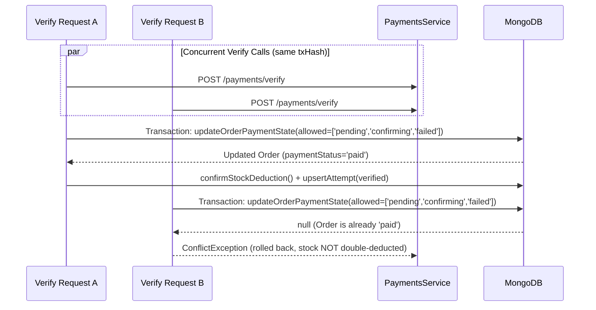

# 11 — Idempotency and Duplicate Prevention

**Idempotency** means executing the same operation multiple times produces the same final state without creating duplicate orders, duplicate payment records, or double-deducting inventory.

---

## Why Duplicate Requests Happen
- React 19 StrictMode double-mounts `useEffect` in development.
- Users double-click **Place Order** or **Pay**.
- Network timeouts trigger retries after the backend already committed.
- Frontend polling (`CryptoPaymentPanel` every 4s) calls `POST /payments/verify` repeatedly for the same `transactionHash`.

---

## 1. Checkout Idempotency (`POST /orders/checkout`)
- `CheckoutClient` generates a client `idempotencyKey` and sends it in `CheckoutDto`.
- `OrderSchema` enforces a unique partial index:
  ```typescript
  OrderSchema.index(
    { user: 1, idempotencyKey: 1 },
    { unique: true, partialFilterExpression: { idempotencyKey: { $type: 'string' } } },
  );
  ```
- `OrdersService.checkout()` checks `findByIdempotencyKey(userId, idempotencyKey)` and rejects duplicates with `409 ConflictException`.

---

## 2. Payment Initiation Idempotency & `E11000` Recovery (`POST /payments/initiate`)

### Real Failure Scenario: `E11000 duplicate key error`
Previously, if two concurrent `POST /payments/initiate` requests arrived simultaneously (e.g., React StrictMode double-mounting `CryptoPaymentPanel` auto-init):
1. Both saw `findLatestByOrderAndUser(...) === null` and `countByOrder(...) === 0`.
2. Both generated `paymentReference = order.paymentReference`.
3. The second `insertOne` crashed with:
   `E11000 duplicate key error collection: GridLine.payments index: paymentReference_1 dup key`

### Current Prevention & Recovery
1. **Frontend in-flight lock (`CryptoPaymentPanel.tsx`)**: `initiateInFlightRef` blocks concurrent `ensureInitiated()` calls in the browser.
2. **Reuse active attempts (`PaymentsService.initiatePayment`)**:
   - If `latestPayment` is `pending`/`confirming` **with** a `transactionHash`, returns it immediately.
   - If `latestPayment` is `pending` **without** a `transactionHash`, updates it in place instead of inserting a new row.
3. **Graceful `E11000` catch (`PaymentsService.initiatePayment`)**:
   ```typescript
   } catch (error) {
     if (this.isDuplicateKeyError(error)) {
       const concurrentPayment =
         await this.paymentRepository.findLatestByOrderAndUser(dto.orderId, userId);
       if (
         concurrentPayment &&
         (concurrentPayment.verificationStatus === 'pending' ||
           concurrentPayment.verificationStatus === 'confirming')
       ) {
         return this.formatPayment(concurrentPayment);
       }
       throw new ConflictException(
         'A payment attempt is already being prepared for this order. Please retry.',
       );
     }
     throw error;
   }
   ```

---

## 3. Concurrent Verification & `txHash` Replay Prevention (`POST /payments/verify`)



- **Already-paid fast path**: If `order.paymentStatus === 'paid'` when `verifyPayment` starts, and `findVerifiedByOrder` matches `txHash`, it returns the verified payment (`200 OK`) idempotently.
- **Cross-order `txHash` uniqueness**: Enforced in `PaymentsService` (`findByChainAndTxHash`) **and** by MongoDB unique partial index `{ chainId: 1, transactionHash: 1 }`.

> **Explicit Gap**: If a MongoDB replica set is *not* enabled (standalone dev MongoDB), `executeWithOptionalTransaction()` falls back to running without multi-document transactions (`isStandaloneTransactionError`). In that mode, `updateOrderPaymentState` still uses atomic `findOneAndUpdate` preconditions so stock is not double-deducted, but a crash mid-flight would not roll back across collections. Production **must** run MongoDB as a replica set (e.g., MongoDB Atlas).
