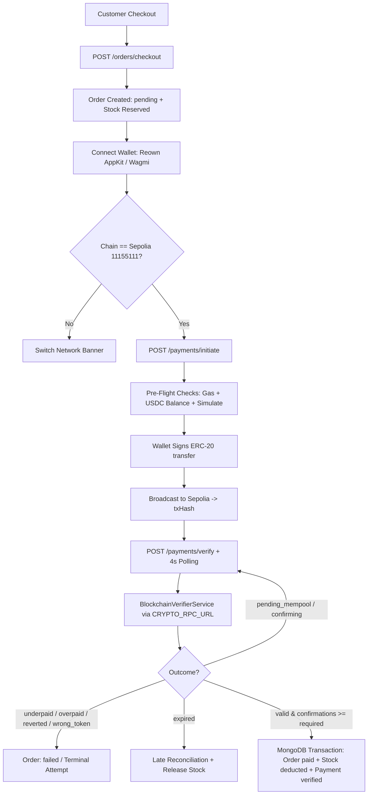

# APEX ATELIER — Crypto Payment Documentation

Comprehensive, code-backed developer documentation for the **APEX ATELIER** cryptocurrency payment system on **Ethereum Sepolia (`chainId: 11155111`)** using **ERC-20 USDC** (or native ETH when `CRYPTO_TOKEN_ADDRESS` is unset and `CRYPTO_TOKEN_SYMBOL=ETH`).

> **Scope & Truthfulness**: Every file path, symbol, status enum, endpoint, and behavior in this directory reflects the **actual implementation** in `backend/` and `client-web/`. Missing production safeguards (such as background cron reconciliation, RPC failover, or rate limiting) are explicitly labeled **Not implemented** or **Partially implemented**.

---

## Architecture at a Glance

---

## Reading Guide (Sequential Learning Index)

| # | Document | Focus |
| :--- | :--- | :--- |
| 01 | [Architecture Overview](./01-architecture-overview.md) | End-to-end layers, module boundaries, trust model |
| 02 | [Libraries & Dependencies](./02-libraries-and-dependencies.md) | Reown AppKit, Wagmi, Viem, React Query, NestJS, Mongoose |
| 03 | [Crypto Payment Flow](./03-crypto-payment-flow.md) | Step-by-step walkthrough from Checkout to Finality |
| 04 | [Checkout Integration](./04-checkout-integration.md) | `CheckoutClient`, `CryptoPaymentPanel`, COD conversion, resume |
| 05 | [Order & Payment Lifecycle](./05-order-and-payment-lifecycle.md) | Status enums, state machines, irreversible transitions |
| 06 | [Blockchain Transaction Fundamentals](./06-blockchain-transaction-fundamentals.md) | Gas, nonce, txHash, receipts, ERC-20 `Transfer` logs |
| 07 | [Wallet Connection](./07-wallet-connection.md) | Reown AppKit, Wagmi, `useEvmWallet`, SSR hydration |
| 08 | [Payment Creation](./08-payment-creation.md) | `initiatePayment`, `BigInt` math, attempt recovery |
| 09 | [Blockchain Verification](./09-blockchain-verification.md) | Server-side JSON-RPC checks in `BlockchainVerifierService` |
| 10 | [Confirmations & Finality](./10-confirmations-and-finality.md) | Mempool, block confirmations, 4s polling, manual refresh |
| 11 | [Idempotency & Duplicate Prevention](./11-idempotency-and-duplicate-prevention.md) | `idempotencyKey`, `E11000` recovery, txHash replay protection |
| 12 | [Underpayment & Overpayment Handling](./12-underpayment-overpayment-handling.md) | Exact-match `BigInt` policy, terminal rejection rules |
| 13 | [Payment Security](./13-payment-security.md) | Threat model table, trust boundaries, private key safety |
| 14 | [Database Models & Relations](./14-database-models-and-relations.md) | `Order` & `Payment` schemas, indexes, 1-to-many attempts |
| 15 | [API Endpoints](./15-api-endpoints.md) | Routes, DTOs, headers, responses, error codes |
| 16 | [Error Handling & Recovery](./16-error-handling-and-recovery.md) | User rejection, timeout, late tx reconciliation, failure matrix |
| 17 | [Environment Configuration](./17-environment-configuration.md) | Backend & frontend env vars, Joi validation, zero-address guard |
| 18 | [Testing Guide](./18-testing-guide.md) | Local Sepolia testing, faucets, negative cases, Jest suite |
| 19 | [Debugging Guide](./19-debugging-guide.md) | Problem / Cause / Investigation / Solution playbook |
| 20 | [Production Readiness](./20-production-readiness.md) | Audit checklist of Implemented vs Missing safeguards |

---

## Key Codebase Files

- **Backend**:
  - `backend/src/modules/payments/payments.controller.ts`
  - `backend/src/modules/payments/payments.service.ts`
  - `backend/src/modules/payments/services/blockchain-verifier.service.ts`
  - `backend/src/modules/payments/repositories/mongo-payment.repository.ts`
  - `backend/src/modules/payments/schemas/payment.schema.ts`
  - `backend/src/modules/payments/dto/initiate-payment.dto.ts` & `verify-payment.dto.ts`
  - `backend/src/modules/orders/orders.service.ts` & `schemas/order.schema.ts`
  - `backend/src/config/config.validation.ts`
- **Frontend**:
  - `client-web/src/lib/web3/wallet-config.ts`
  - `client-web/src/components/providers/Web3Provider.tsx`
  - `client-web/src/hooks/useEvmWallet.ts`
  - `client-web/src/components/checkout/CheckoutClient.tsx`
  - `client-web/src/components/checkout/CryptoPaymentPanel.tsx`
  - `client-web/src/lib/api/payments.api.ts` & `client-web/src/types/payment.types.ts`

---

## Current Implementation Summary

- **Implemented**: Order-first checkout with atomic stock reservation, idempotent `POST /orders/checkout`, Reown AppKit + Wagmi + Viem multi-wallet UI, pre-flight balance & `simulateContract` checks, server-side JSON-RPC verification (`BlockchainVerifierService`), `BigInt` exact-match amount validation, confirmation polling, late-tx reconciliation, `E11000` concurrent `initiatePayment` recovery, and read-only Admin Payments ledger.
- **Not Implemented (Production Gaps)**: Automated background reconciliation cron for abandoned/timed-out orders, multi-RPC provider failover, webhook/indexer ingestion, and HTTP rate limiting on `/payments/*`. See [Production Readiness](./20-production-readiness.md).
