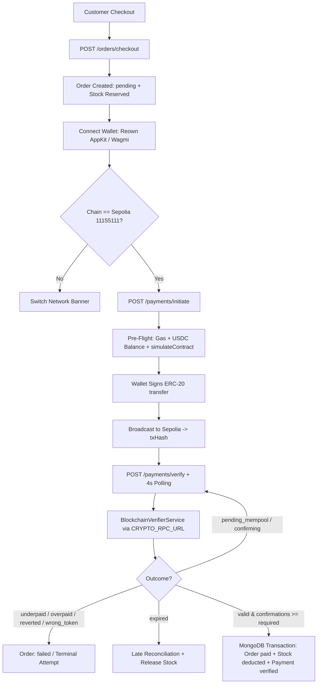

# APEX ATELIER — Crypto Payment Documentation

Technical documentation for the **APEX ATELIER** cryptocurrency payment system on **Ethereum Sepolia (`chainId: 11155111`)** using **ERC-20 USDC** (or native ETH when `CRYPTO_TOKEN_ADDRESS` is unset and `CRYPTO_TOKEN_SYMBOL=ETH`).

> **Scope**: Every file path, symbol, status enum, endpoint, and behavior in `docs/payments/` reflects the **actual implementation** in `backend/` and `client-web/`. Missing production safeguards are explicitly marked **Missing** or **Partially implemented**.

---

## Architecture Overview

---

## Documentation Index

| # | Document | Topics Covered |
| :--- | :--- | :--- |
| 01 | [Architecture & Dependencies](./01-architecture-and-dependencies.md) | Layered NestJS + Repository architecture, module boundaries, frontend Web3 & Axios stack, installed libraries |
| 02 | [End-to-End Payment Flow](./02-end-to-end-payment-flow.md) | Cart → Checkout → Order → Payment → Wallet → Verification → Completion, COD conversion, API endpoints & DTOs |
| 03 | [Wallet & Blockchain Verification](./03-wallet-and-blockchain-verification.md) | EVM fundamentals, Reown AppKit + Wagmi + Viem, pre-flight checks, `BlockchainVerifierService`, confirmations & polling |
| 04 | [Payment State & Idempotency](./04-payment-state-and-idempotency.md) | `Order` & `Payment` schemas, indexes, status lifecycles, `BigInt` math, `E11000` recovery, `txHash` replay protection |
| 05 | [Security, Errors & Recovery](./05-security-errors-and-recovery.md) | Threat model, underpayment/overpayment rejection, wrong network/token, expired reconciliation, RPC/wallet recovery |
| 06 | [Testing & Production Guide](./06-testing-and-production-guide.md) | Environment variables, Jest tests, Sepolia manual testing, debugging playbook, production readiness checklist |

---

## Key Codebase Files

- **Backend (`backend/src/`)**:
  - `modules/payments/payments.controller.ts` & `admin-payments.controller.ts`
  - `modules/payments/payments.service.ts` & `admin-payments.service.ts`
  - `modules/payments/services/blockchain-verifier.service.ts`
  - `modules/payments/repositories/mongo-payment.repository.ts` & `interfaces/payment-repository.interface.ts`
  - `modules/payments/schemas/payment.schema.ts` & `dto/` (`initiate-payment.dto.ts`, `verify-payment.dto.ts`)
  - `modules/orders/orders.service.ts`, `repositories/mongo-order.repository.ts`, `schemas/order.schema.ts`
  - `config/config.validation.ts`
- **Frontend (`client-web/src/`)**:
  - `lib/web3/wallet-config.ts` & `components/providers/Web3Provider.tsx`
  - `hooks/useEvmWallet.ts`
  - `components/checkout/CheckoutClient.tsx` & `CryptoPaymentPanel.tsx`
  - `lib/api/payments.api.ts`, `lib/api/axios-instance.ts`, `lib/api/api-fetch.ts`, `types/payment.types.ts`

---

## Implementation Status at a Glance

- **Implemented**: Order-first checkout with atomic stock reservation, idempotent `POST /orders/checkout`, Reown AppKit + Wagmi + Viem multi-wallet UI, pre-flight gas/USDC/simulation checks, server-side JSON-RPC verification, `BigInt` exact-match amount validation, 4s confirmation polling, late-tx reconciliation, `E11000` concurrent `initiatePayment` recovery, and read-only `/admin/payments`.
- **Not Implemented (Production Gaps)**: Background cron/worker for expiring abandoned orders and polling `confirming` payments, multi-RPC failover, webhook/indexer ingestion, and HTTP rate limiting (`@nestjs/throttler`).
